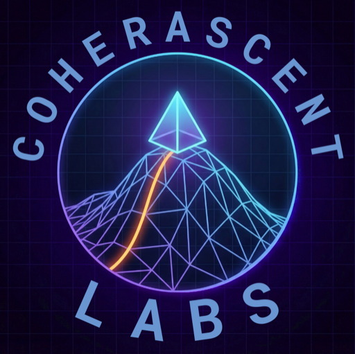

# Coherascent Labs



An experimental multi-page marketing site for Coherascent Labs, built as a static website with custom HTML, CSS, and JavaScript.

The site presents Coherascent as a dual-pillar organization:
- `Research`: neuro-symbolic, deterministic, and truth-aligned AI work
- `Lune Synth`: educational product concepts for handwritten reasoning, grading, and adaptive learning

## Update Log

- 2026-10-28: Verified the published language gallery: the live homepage and controller use cache version 5, and all 18 served WebPs match their reviewed SHA-256 hashes. Final local browser coverage passed all 72 viewport/locale/screen combinations plus the no-JavaScript English fallback. The full website suite retains the same five pre-existing offer/retired-Pro assertions as its clean baseline.

- 2026-10-28: Completed the language-gallery refresh with German, Brazilian Portuguese, Simplified Chinese, Japanese and Korean Home retakes. All 18 Home/Shop screenshots now use current native screens, readable notebook labels, loaded artwork and matched 1290×2796 frames. Preserved exact-byte review records and both final contact sheets; versioned the final batch for returning visitors.

- 2026-10-28: Re-captured all nine translated Shop previews from the current native layout, with Moon Rock Shop first and overlapping examples for frames, ships, XP boosts and Cryonics. Individually reviewed all nine full-frame WebPs, refreshed their exact-byte provenance and rotated the gallery cache version.

- 2026-10-28: Re-captured English, Spanish, French and Hindi Home language previews with readable native notebook labels and loaded clock, bulb and ship artwork. Versioned the gallery and initial image for returning visitors, standardized frame dimensions, and extended exact-byte review coverage to English Home. Remaining Home locales and the Shop refresh follow as reviewed batches.

- 2026-10-27: Gave all four Tock carousel phones distinct 3D entrance angles and delayed each hidden phone’s one-shot entrance until it becomes visible. Reused the existing chassis transition and Tock visibility observer; resting layout, manual rotation, screenshots and mobile/reduced-motion fallbacks are preserved. Browser QA confirmed four actual entrance transitions and both fallbacks; 28 focused tests and the 165-page screenshot guard passed. Full website tests remain 81/86, reproducing the same five offer/retired-Pro failures on clean baseline `f4c782aa`; no assertions were changed. Exact results are in `docs/qa/2026-10-27-tock-entrances/`.

- 2026-10-27: Restored entrance rotation for About's two phone previews and six square-on center phones in three-device galleries, retaining their final poses. Centralized deferred device wiring in an idempotent updater and the campaign generator, refreshed tilt assets across every discovered active phone page, and added an all-route motion/keyboard/fallback browser matrix. Automatic entrance remains desktop/fine-pointer only with reduced motion respected; existing user-initiated rotation and mobile fallback are unchanged. The real-server browser matrix passed all 165 active phone routes (710 runtime devices, including inserted devices); the screenshot guard retained all 27 accepted exports.

- 2026-10-27: Updated both Tock wardrobe secrets to three ordered steps: first time, any genuine risk-slider adjustment, then a distinct final time. The website explicitly requests the additive v2 contract and fails closed on legacy or malformed responses. Production v2 support was verified before publishing; older compatible app versions retain their limited whole-step risk range, while unrestricted slider movement requires the app update.

- 2026-10-27: Added a calligraphic globe to the Learn Your Way heading and all landing-page menu entries, using the same family-matched bitmap as a color-following mask. Versioned shared styles for returning visitors and preserved the original artwork, prompt, references, master and alpha-review evidence in project-owned authoring assets.

- 2026-10-27: Constrained the expanded Engine audit to its card width on small screens. Kept historical prose and figures unchanged, wrapped long audit headings and retained horizontal scrolling inside the comparison table's existing wrapper.

- 2026-10-27: Clarified the Engine's four supported follow-up choices as similar, easier, harder and custom practice; avoided presenting a new practice set as an additional follow-up mode.

- 2026-10-27: Aligned the Engine explanation with the current practice-preparation, answer-key and rubric-feedback paths. Bounded automated-review and score-check claims, removed unsupported universal confidence guarantees and made the four-step explanation accessible. Preserved the design, historical benchmark values, confidence intervals, adjudication limits and dated OCR-fixture caveat.

- 2026-10-27: Reused one canonical phone chassis for landing heroes and the Learn Your Way preview, including existing physical side keys and shared desktop/mobile tilt behavior. Added Learn Your Way to all 165 landing-page menus through an idempotent shared navigation helper used by the campaign generator; retained existing items and page content.

- 2026-10-27: Kept the Earth backdrop on a static poster when visibility observation is unavailable, with zero attached video sources. Deferred each outgoing layer's rewind until its next hidden reuse so a late opacity transition keeps its decoded frame. Preserved the failed fallback and intermittent readiness assertions; final controller checks retain the same opacity/readiness thresholds.

- 2026-10-27: Unified Learn Your Way into one Medals-width feature card with a larger phone preview beside its language and accessibility copy. Added a tinted Earth backdrop with one-second two-layer crossfades; both muted video sources unload offscreen, in the background and for reduced motion. Preserved all nine-language Home/Shop previews and selected-image accessibility; actual-host browser checks cover 72 gallery states and two real video loops.

- 2026-10-27: Fixed the shared modal's unwired X button and versioned its script URL. Added actual-browser close/reopen, mouse/touch/keyboard, Escape and focus-restoration coverage for the Tock reward and public store dialogs; retained the failing pre-fix reproduction.

- 2026-10-27: Expanded the Engine card to the same full container width as Medals and made the homepage story link a clearly filled button, with a 48px target, hover feedback, visible keyboard focus and reduced-motion support. Preserved its existing text and About-page destination.

- 2026-10-27: Corrected the Earth background video and poster URLs to the existing `/lune-synth/videos/` production routes. The initial local preview accepted `/videos/` paths that the production host does not map; live route checks caught the mismatch after publishing.

- 2026-10-27: Matched the Focus with Tock card to the Medals card's full container width. Added the supplied eight-second Earth video behind Learn your way, with a static poster, muted inline playback, viewport/visibility pauses and reduced-motion fallback. Preserved the original 720p video stream without re-encoding, removed background audio and recorded source/delivery hashes in the video provenance file.

- 2026-10-26: Re-captured eight translated Home previews, nine Shop previews and five language-study questions (22 native frames, 27 WebPs). Corrected visible language mismatches while preserving target-language exercises, and updated Shop artwork to three overlapping examples. Added an exact-hash/locale capture-review manifest and broader screenshot checks; fixed stale gallery loads and selected-image accessibility.

- 2026-10-26: Versioned the published Tock clock stylesheet URL so returning visitors fetch the refined design instead of retaining the prior immutable cached CSS.

- 2026-10-26: Added the 3D Luna video campaign plan with all 120 requested learner/audience destinations, five navigation hubs, reusable owned-model rendering, free waitlist terms, platform-specific publishing constraints and proposed measurement/spending gates. This publishes a plan; it does not launch ads, upload videos or authorize spending.

- 2026-10-26: Refined the interactive Tock clock with a fluted metal bezel, dark sunburst dial, luminous indices and sword hands. Preserved keyboard/pointer controls and reduced-motion behavior; desktop/mobile visual and interaction checks passed.

- 2026-10-26: Made social-media app blocking explicit in the homepage’s Tock focus-timer copy, retaining the existing coming-soon availability note.

- 2026-10-26: Re-captured the homepage’s four Tock screenshots from the current simplified native timer, fullscreen viewer and Wardrobe. Easter Egg, Golden Egg, Gold medal and wizard/Gem Shades outfits each use a distinct app theme, with matching updated alternative text and cache versions. All eight full/480px exports were individually inspected; the screenshot guard passes across 165 landing pages.

- 2026-10-26: Replaced duplicated second-slot screenshots on nine study pages with distinct native app questions for each subject, each with its own color theme, full subject badge and 9:41 status bar. Updated captions and alternative text to match; exported full and 480px WebP assets. All eighteen exports were individually inspected; the screenshot guard passes across 165 landing pages.

- 2026-10-23: Replaced the Voice and Text phone screenshots in the "Don't want to handwrite?" section with current-UI captures (the previous shots predated recent QuestionScreen UI changes), and added a new 11-inch iPad Pro screenshot of a multiple-choice question with a diagram to the Choice tab, which previously only showed a phone. Captures came from the mobile app's dev website-showcase harness (sample content, no personal data); existing Voice/Text iPad shots are unchanged.

- 2026-10-22: Centered the mobile homepage tagline and sized it fluidly with the viewport so it fits one line; desktop typography is unchanged.

- 2026-10-22: Website discoveries now reveal two ordered time/risk settings for the standard Easter Egg and three for Golden Egg, with rotating sequences, slider percentages and matching app-update guidance.

- 2026-10-22: Made Jupiter the homepage Constellations overview’s default world, including its selected option, icon, frame theme, video and poster, for variety after the opening hook video.

- 2026-10-22: Removed the “Solve it yourself, then get feedback.” paragraph above the Lune Synth homepage brain illustration.

- 2026-10-01: Renamed the annual plan to Lune Synth Pro Special Offer on the homepage and Pro page. Its headline is $4.99/month, billed annually at $59.88/year (exactly twelve monthly equivalents); annual renewal disclosures, metadata, and visible/structured FAQs match. Monthly remains $12.99, the seven-day annual trial remains eligibility-based, and the red annual styling and existing launch offers are preserved. Website only; configure the matching Stripe annual Price before enabling purchases.

- 2026-10-01: Updated pricing cards on the homepage and Pro page to the requested blue Free, purple monthly, and red annual color scheme, including matching price, border, button, badge, and hover accents. Preserved animations and reduced-motion support; refreshed stylesheet cache versions.

- 2026-10-01: Redesigned the Lune Synth Pro page with animated learning, benefits, pricing, and launch-offer cards in an ink/parchment/gold/sage/clay palette. Annual launch pricing is $59.99; monthly stays $12.99. Homepage pricing matches. Paid checkout remains unavailable until billing launches.

## Live Structure

The production site is served from one Railway deployment with host-based routing:

| Domain / Route | Purpose |
| --- | --- |
| `https://coherascentlabs.com/` | Main landing page |
| `https://coherascentlabs.com/research/` | Research overview and technical program |
| `https://lunesynth.com/` | Lune Synth product experience |

Legacy compatibility stubs still exist:
- `research.html` redirects to `/research/`
- `applied.html` redirects to `https://lunesynth.com/`
- `/lune-synth/` redirects to `https://lunesynth.com/` on the primary domain

## What’s In The Site

### Home
- dual-pillar hero and brand framing
- interactive `Tower of Hanoi` demo
- interactive orbital canvas scene
- theme toggle with persisted preference via `localStorage`

### Research
- long-form research overview
- initiative cards and technical visuals
- shared brand/theme system with a purple-biased research starfield

### Lune Synth
- notepad-style `Platform Components` showcase
- animated handwritten-response slideshow
- synchronized question-phone UI
- `Screenshot Workflow` phone sequence for capture, grading, and feedback
- `Voice Upload` concept section
- shared phone rendering system with consistent proportions, hardware buttons, and theme-aware UI

## Stack

This repo intentionally stays simple:

- plain `HTML`
- custom `CSS` embedded per page
- plain `JavaScript`
- no framework
- no bundler
- no build step

Fonts are loaded from Google Fonts and the site uses local images, SVGs, and handwritten animation scripts.

## Local Development

Because the production deployment routes by domain, run the Node server instead of a generic static server when testing locally.

```bash
cd /Users/griffinrutherford/Documents/coherascent-labs
npm start
```

Then test the host-specific routes with `curl`:

- `curl -H "Host: coherascentlabs.com" http://localhost:3000/`
- `curl -H "Host: coherascentlabs.com" http://localhost:3000/research/`
- `curl -H "Host: lunesynth.com" http://localhost:3000/`

## Project Map

```text
.
├── index.html
├── research/
│   └── index.html
├── lune-synth/
│   └── index.html
├── applied/
│   └── index.html              # legacy redirect stub
├── research.html                  # redirect stub
├── applied.html                   # legacy redirect stub
├── applied-response-slideshow.js # response carousel logic
├── applied-handwriting-demo.js   # animated handwriting SVG logic
├── images/                       # research visuals
├── mobile-app-plan.md           # app implementation plan
└── mobile-app-assets/           # tokens, icons, UML diagrams
```

## Key Interaction Notes

### Theme system
- all three pages share the same `coherascent-theme` localStorage key
- each page has its own starfield treatment tuned to the page’s visual role
- the Lune Synth page also has theme-aware phone UI states

### Handwriting system
- the Lune Synth slideshow reveals handwriting line-by-line and character-by-character
- word wrapping is precomputed so words do not jump awkwardly to a new line mid-write
- reduced-motion users get a stable static rendering instead of the full animation sequence

### Phone mockups
- workflow phones use shared sizing variables
- phone proportions are normalized across breakpoints
- the Lune Synth page includes consistent shell geometry, camera island treatment, and side hardware buttons

### Screenshot verification

Run `scripts/check-landing-screenshots.test.py` and `scripts/check-landing-screenshots.py` with Python 3, using the shared Mac's current resource governor. The guard checks responsive image candidates, CSS/data screenshot backgrounds, video posters, shared feature-panel media and all nine locales in the dynamic Home/Shop gallery, as well as language-page placement, missing files, sharing and duplicate shots.

The [language and Shop capture manifest](mobile-app-assets/screenshots/2026-10-26-language-review.json) binds each changed export to its independently reviewed bytes, UI locale, exact app fixture commit and native PNG hash. Replacing a reviewed image requires opening the actual full/mid export again and recording fresh acceptance. Hash checks establish provenance; they cannot judge translation quality. Keep intentional language-learning stimuli in their target language while matching instructional UI text to the pictured interface. Native DEV captures demonstrate the pictured UI, not signed-build or live-model acceptance.

## Notes

- `index-vibe.html` is a sidecar concept file and not part of the main directory-routed site
- some favicon source assets are kept separately from the currently used favicon files
- the site is optimized as a polished static experience, not as a CMS-backed marketing stack
- `docs/legal/` contains the legal source files; run `npm run build:legal` to regenerate the local `/privacy/` and `/terms/` pages
- the legal pages are linked site-wide from the footer (`campaign/site-footer.js`) and from every blog page, so they are publicly reachable wherever the site is deployed
- they are gated by `DRAFT` in `scripts/build-legal-pages.js`, which keeps the draft banner and `noindex` in place while `[[TOKEN]]` placeholders remain; flip it to `false` only after completing the entity, contact, governing-law, venue, and effective-date checklist in `docs/legal/README.md`

## Next Good Improvements

- extract the shared theme script into a single reusable file
- extract the shared starfield/phone CSS into reusable assets instead of duplicating per page
- add a tiny local dev script or simple static-server config
- add visual regression screenshots for the main breakpoints
